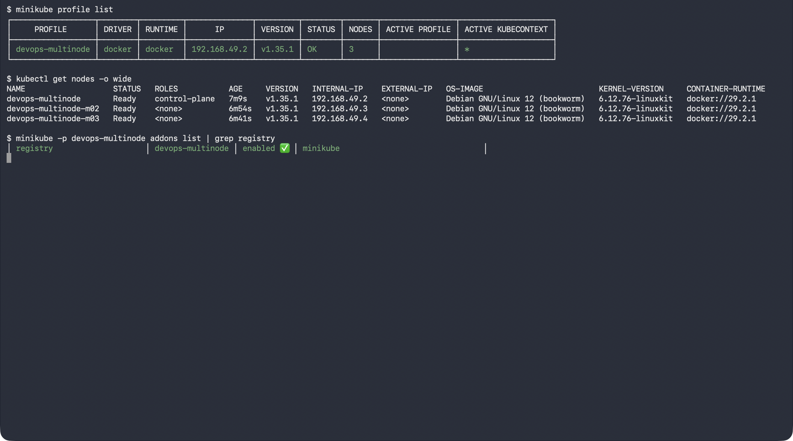
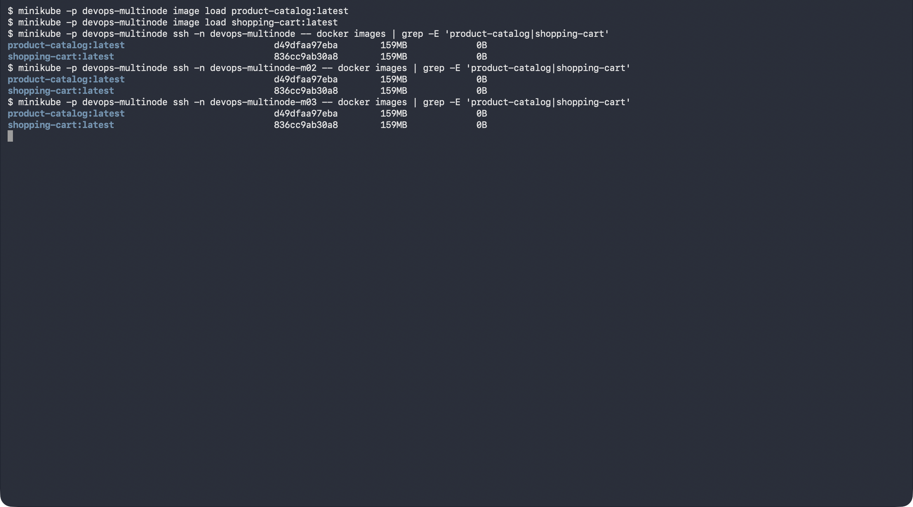
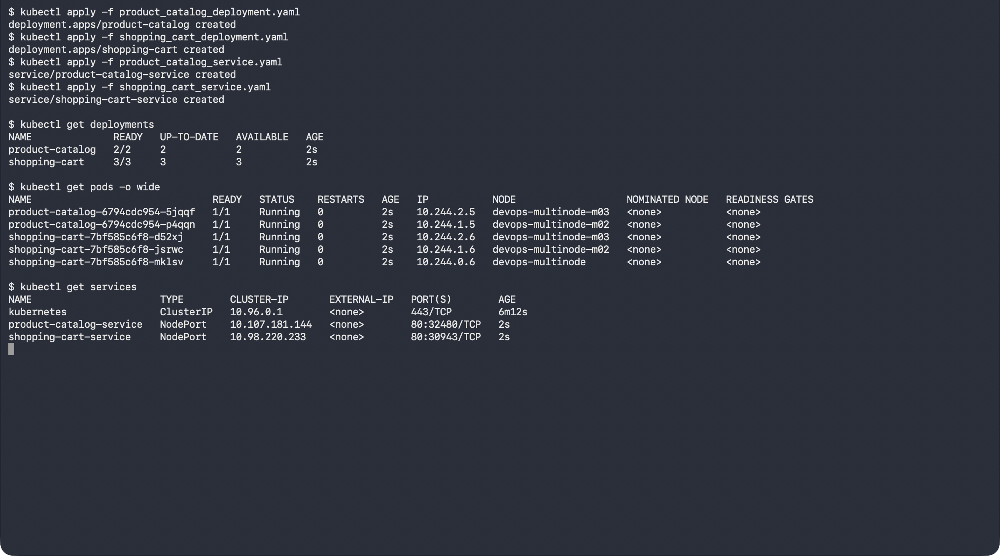
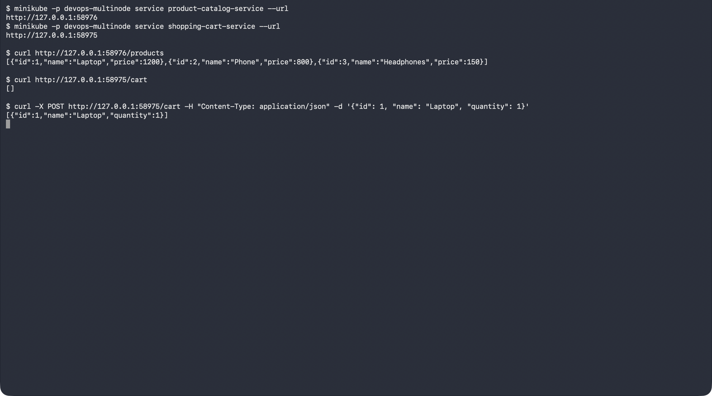

# Exercise 10: Multi-Node Kubernetes Cluster with Multiple Applications and ReplicaSets

## Objective

Run two services of an e-commerce platform on a three-node Minikube cluster,
with replicas spread across nodes for availability:

- **Product Catalog** (AppA): 2 replicas
- **Shopping Cart** (AppB): 3 replicas

## Environment

- Operating System: macOS (Apple Silicon)
- Container Runtime: Docker Desktop
- Kubernetes: Minikube (docker driver), profile `devops-multinode`, 3 nodes, Kubernetes v1.35.1

## Files

| File | Purpose |
|------|---------|
| [product_catalog.py](./product_catalog.py) | Flask app, `GET /products` |
| [shopping_cart.py](./shopping_cart.py) | Flask app, `GET /cart` and `POST /cart` |
| [Dockerfile.product](./Dockerfile.product), [Dockerfile.shopping](./Dockerfile.shopping) | Images for the two apps |
| [product_catalog_deployment.yaml](./product_catalog_deployment.yaml) | Deployment, 2 replicas, pod anti-affinity |
| [shopping_cart_deployment.yaml](./shopping_cart_deployment.yaml) | Deployment, 3 replicas, pod anti-affinity |
| [product_catalog_service.yaml](./product_catalog_service.yaml), [shopping_cart_service.yaml](./shopping_cart_service.yaml) | NodePort Services |

## Adjustments to the Exercise

- **No `--force`:** the exercise adds `--force` because it runs as root on Linux; on macOS Minikube runs as a normal user, so it is not needed. `--memory=1800 --cpus=2` was added so three nodes fit comfortably in Docker Desktop's memory.
- **Namespace:** the exercise's shopping-cart Deployment uses `namespace: devops-exercise` while its Service is in `default`, so the Service would find no pods. Both Deployments use `default`, matching the exercise's own expected output.

## Step 0–1: Create the Three-Node Cluster

```bash
minikube stop
minikube delete
minikube start --nodes 3 -p devops-multinode --memory=1800 --cpus=2
minikube -p devops-multinode addons enable registry
```

All three nodes (`devops-multinode`, `-m02`, `-m03`) are `Ready` and the
registry add-on is enabled:



## Steps 2–5: Build the Images and Load Them into Every Node

```bash
docker build -t product-catalog:latest -f Dockerfile.product .
docker build -t shopping-cart:latest -f Dockerfile.shopping .
minikube -p devops-multinode image load product-catalog:latest
minikube -p devops-multinode image load shopping-cart:latest
```

`minikube image load` copies the images onto every node, which matters here
because the Deployments use `imagePullPolicy: Never` and pods are scheduled
on all three nodes. Both images are present on each node:



## Steps 6–8: Deploy, Expose and Check Pod Distribution

```bash
kubectl apply -f product_catalog_deployment.yaml
kubectl apply -f shopping_cart_deployment.yaml
kubectl apply -f product_catalog_service.yaml
kubectl apply -f shopping_cart_service.yaml
kubectl get pods -o wide
```

The `podAntiAffinity` rule (`topologyKey: kubernetes.io/hostname`) forbids
two pods of the same app on one node, so:

- the 2 Product Catalog pods run on `devops-multinode-m02` and `devops-multinode-m03`
- the 3 Shopping Cart pods run one per node: `devops-multinode`, `-m02` and `-m03`



## Steps 9–10: Access and Test the Services

```bash
minikube -p devops-multinode service product-catalog-service --url
minikube -p devops-multinode service shopping-cart-service --url
```

With the Docker driver on macOS these commands open a local tunnel
(`http://127.0.0.1:<port>`) that stays up while the command runs.

```bash
curl http://127.0.0.1:<catalog-port>/products
curl http://127.0.0.1:<cart-port>/cart
curl -X POST http://127.0.0.1:<cart-port>/cart -H "Content-Type: application/json" \
  -d '{"id": 1, "name": "Laptop", "quantity": 1}'
```

The catalog returns the three products, the cart starts empty, and the POST
returns the cart with the Laptop added:



> Each Shopping Cart replica keeps its cart in memory, so with three replicas
> behind one Service, consecutive requests may land on different pods and see
> different carts. A shared store (e.g. Redis) would be needed for a real cart.

---

## Result

Two services were deployed on a three-node Minikube cluster, with
anti-affinity placing every replica of the same service on a different node
(2 Product Catalog pods, 3 Shopping Cart pods), and both services responded
correctly through their NodePort Services.
