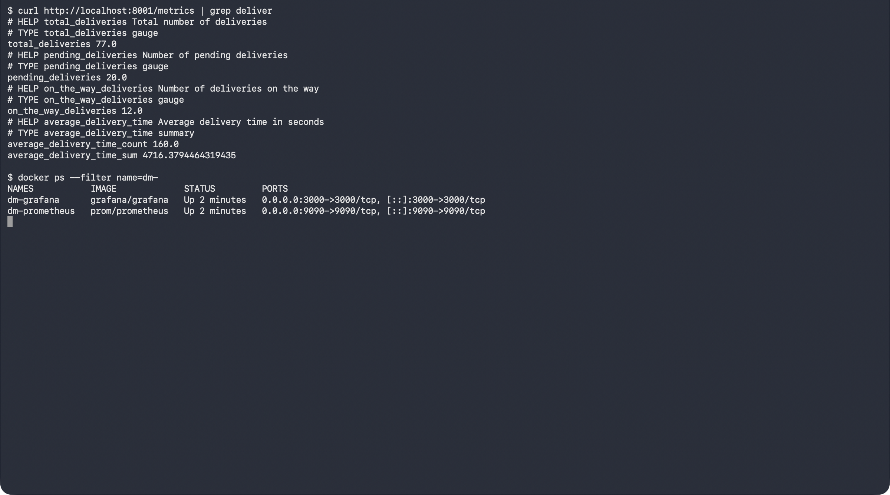
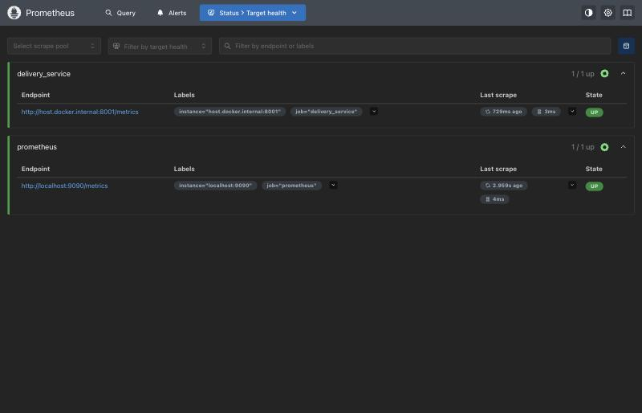
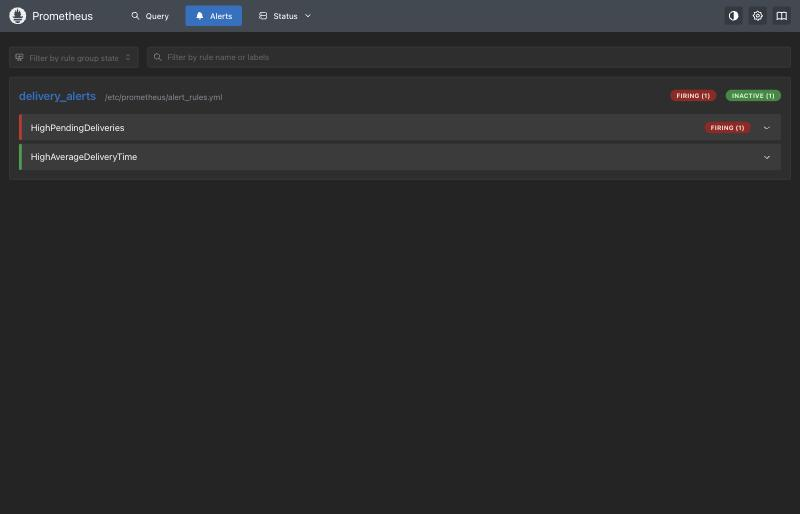
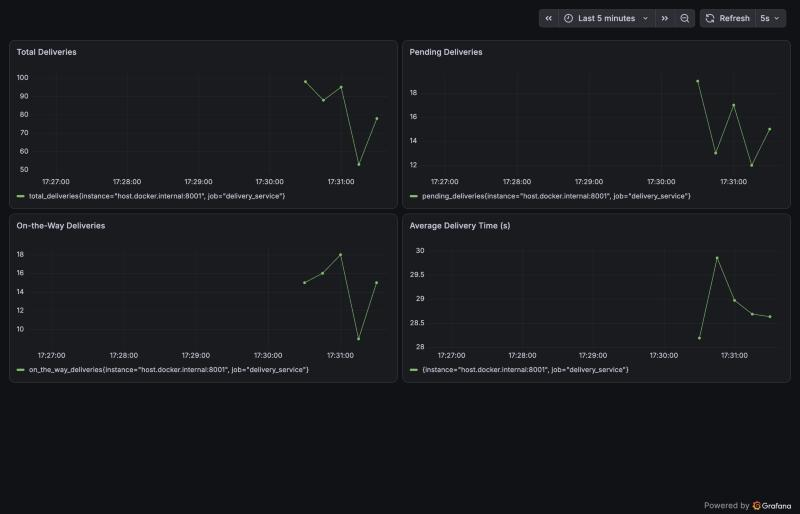
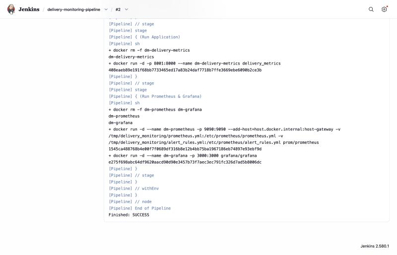
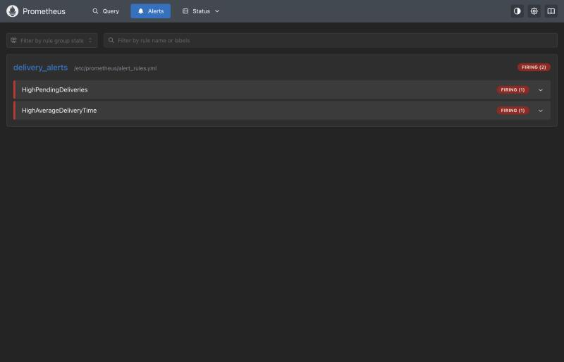

# Exercise 6: Real-Time Operations Monitoring and Alerting

## Objective

Build a monitoring pipeline for a quick-commerce delivery service: a Python
app exposes simulated delivery metrics, Prometheus scrapes them and evaluates
alert rules, Grafana visualises them, and Jenkins automates deployment of the
stack.

## Environment

- Operating System: macOS (Apple Silicon)
- Container Runtime: Docker Desktop
- Python 3.14 (`prometheus-client` in a local venv)
- Prometheus, Grafana 13, Jenkins LTS (all run as Docker containers)

## Files

| File | Purpose |
|------|---------|
| [delivery_metrics.py](./delivery_metrics.py) | Simulates delivery metrics and serves them on `/metrics` |
| [prometheus.yml](./prometheus.yml) | Prometheus scrape config and rule file reference |
| [alert_rules.yml](./alert_rules.yml) | `HighPendingDeliveries` and `HighAverageDeliveryTime` alerts |
| [Dockerfile](./Dockerfile) | Containerises the metrics app (needed by the Jenkins pipeline) |
| [Jenkinsfile](./Jenkinsfile) | Pipeline that builds and deploys the stack |
| [jenkins/Dockerfile](./jenkins/Dockerfile) | Jenkins image with the Docker CLI and pipeline plugin |
| [dashboard.json](./dashboard.json) | Grafana dashboard definition (4 panels) |

## Adjustments for macOS / this machine

- **Metrics port:** the app runs on `8001` (host) instead of `8000`, which was already in use by another container. The Python script reads `METRICS_PORT` (default `8000`).
- **Prometheus target:** `host.docker.internal:8001` instead of `172.17.0.1:8000`. On Docker Desktop for Mac there is no `docker0` bridge on the host, and `--network=host` does not expose services on the Mac, so Prometheus is run with `-p 9090:9090` instead.
- **Scrape interval:** set to `5s` (default `15s`) so graphs and alerts populate quickly.
- **Container names:** prefixed with `dm-` to avoid clashing with other containers on the machine.
- **Jenkins:** port `8081` on the host (`8080` was in use). The stock `jenkins/jenkins:lts` image has no Docker CLI, so the pipeline's first stage would fail; [jenkins/Dockerfile](./jenkins/Dockerfile) adds it, and the host's Docker socket is mounted so the pipeline can start the other containers. The setup wizard is skipped (`runSetupWizard=false`) and the pipeline job is created through Jenkins' REST API.
- **Jenkinsfile:** the exercise's "copy from a local path" stage reads from `/src` (the host folder mounted into Jenkins), a `Dockerfile` is added to the copied files, and bind mounts use the host-side path because the Docker daemon resolves them on the host, not inside the Jenkins container.

## Step 1: Run the Metrics App

```bash
python3 -m venv .venv
.venv/bin/pip install prometheus-client
METRICS_PORT=8001 .venv/bin/python delivery_metrics.py
curl http://localhost:8001/metrics
```

The app publishes `total_deliveries`, `pending_deliveries`,
`on_the_way_deliveries` (gauges) and `average_delivery_time` (summary).

## Step 2: Prometheus and Alert Rules

```bash
docker run -d --name dm-prometheus -p 9090:9090 \
  --add-host=host.docker.internal:host-gateway \
  -v "$PWD/prometheus.yml:/etc/prometheus/prometheus.yml" \
  -v "$PWD/alert_rules.yml:/etc/prometheus/alert_rules.yml" \
  prom/prometheus
```

Metrics endpoint and running containers:



Both scrape targets (`prometheus`, `delivery_service`) report `UP`:



Both alert rules loaded. With the default simulated range (`pending` between 10 and 20) `HighPendingDeliveries` already fires, as the exercise notes intend; `HighAverageDeliveryTime` stays inactive:



## Step 3: Grafana

```bash
docker run -d --name dm-grafana -p 3000:3000 grafana/grafana
```

Added Prometheus as a data source (`http://host.docker.internal:9090`) and
created a dashboard with four panels: Total Deliveries, Pending Deliveries,
On-the-Way Deliveries, and Average Delivery Time
(`average_delivery_time_sum / average_delivery_time_count`). The same
setup was done through Grafana's HTTP API; the dashboard JSON is in
[dashboard.json](./dashboard.json).



## Step 4: Jenkins Pipeline

```bash
docker build -t dm-jenkins jenkins
docker run -d --name dm-jenkins --user root -p 8081:8080 \
  -v /var/run/docker.sock:/var/run/docker.sock \
  -v /tmp/delivery_monitoring:/src:ro dm-jenkins
```

Created a Pipeline job from the [Jenkinsfile](./Jenkinsfile). The stages
are: Pre-check Docker, Setup Workspace, Build Docker Image, Run Application,
Run Prometheus & Grafana. The build finished with `SUCCESS`, and the
metrics app, Prometheus and Grafana containers were started by the pipeline.

> The first run printed `docker info` output into the build log, which
> includes the host's home path, so that command's output is now silenced in
> the Jenkinsfile (`docker info > /dev/null 2>&1`).



## Step 5: Simulate Alerts

Changed the simulated range to `pending = random.randint(50, 100)`, rebuilt
the app container and let Prometheus evaluate for about 40 seconds. Both
alerts moved to `FIRING`:



---

## Result

A working monitoring pipeline: simulated delivery metrics are scraped by
Prometheus, visualised in a four-panel Grafana dashboard, checked against two
alert rules (pending deliveries, average delivery time), and deployed by a
Jenkins pipeline. Raising the pending-deliveries range pushed both alerts into
the firing state.
