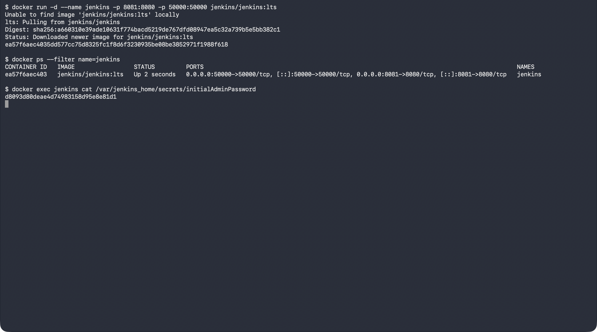
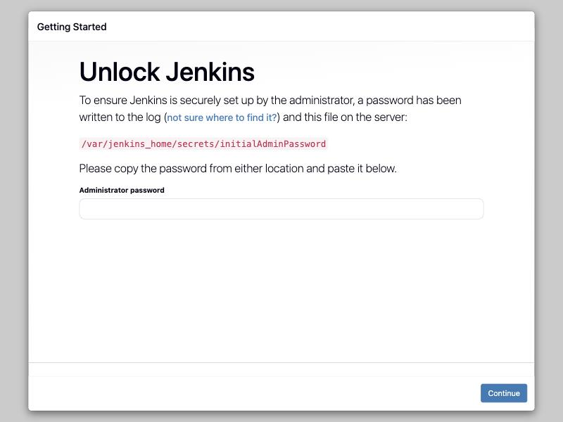
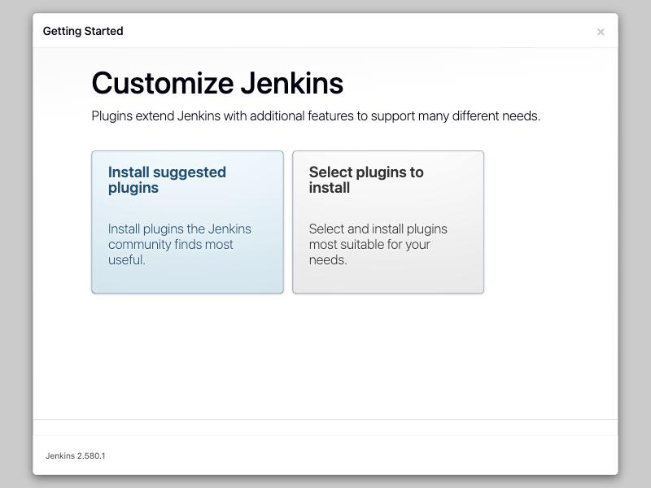
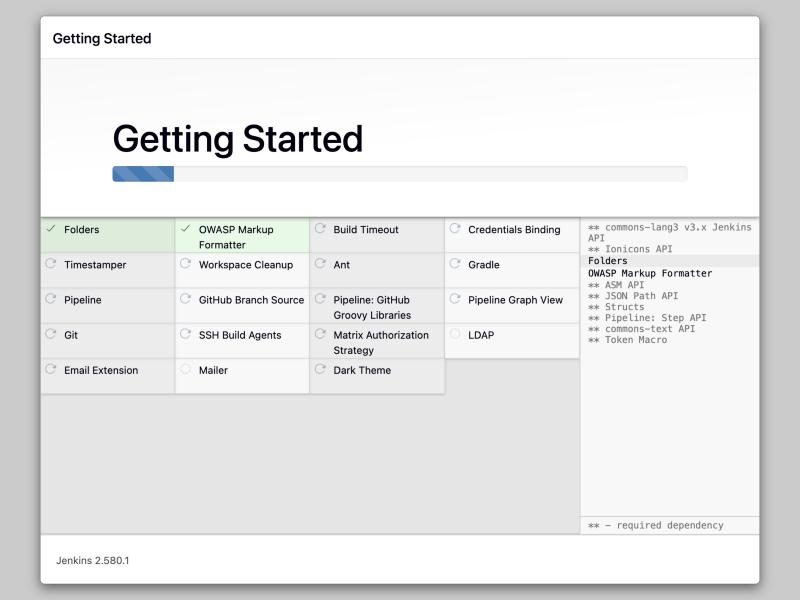
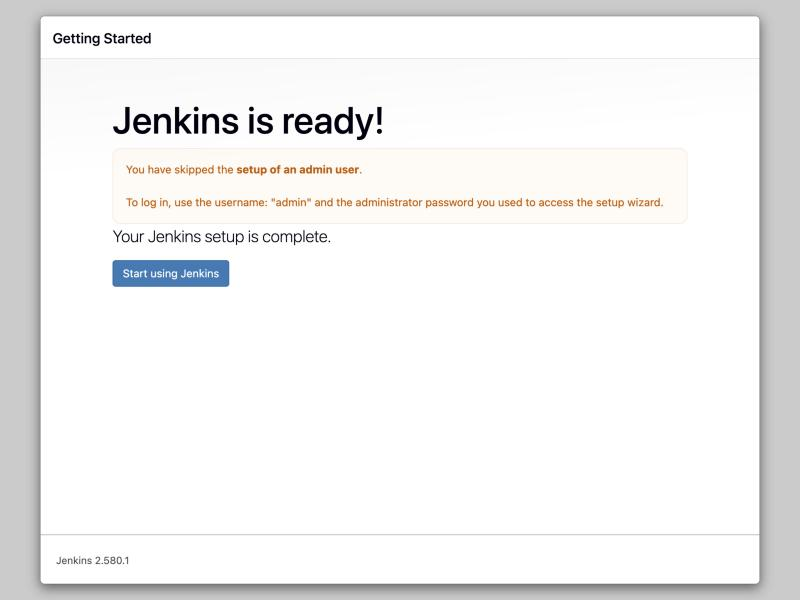
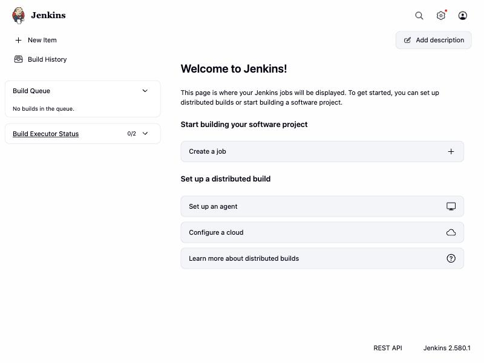

# Exercise 7: Continuous Integration and Jenkins Installation

## Objective

Understand what Continuous Integration (CI) is, and install Jenkins with
Docker: run the container, retrieve the initial admin password, unlock
Jenkins, install the suggested plugins, and reach the Jenkins dashboard.

## Environment

- Operating System: macOS (Apple Silicon)
- Container Runtime: Docker Desktop
- Jenkins: `jenkins/jenkins:lts` (Jenkins 2.580.1)

## Continuous Integration in Brief

CI is the practice of integrating code into a shared repository frequently,
with every change triggering an automated build and test run so problems are
found early. The typical flow is:

1. A developer pushes code to a Git repository.
2. The CI server (Jenkins, GitLab CI, GitHub Actions, CircleCI, ...) detects the change and starts a build.
3. The code is built and automated tests run.
4. Results (success or failure) are reported back to the developer.

Jenkins is an open-source automation server that implements this flow. Its
main concepts are **jobs/projects**, **builds**, **pipelines**, **plugins**
and **nodes** (controller and agents).

## Step 1: Install Jenkins Using Docker

```bash
docker run -d --name jenkins -p 8081:8080 -p 50000:50000 jenkins/jenkins:lts
```

> The exercise uses host port `8080`; port `8081` is used here because
> `8080` was already taken by another container. Port `50000` is the agent
> communication port.

## Step 2: Check the Container and Get the Initial Admin Password

```bash
docker ps --filter name=jenkins
docker exec jenkins cat /var/jenkins_home/secrets/initialAdminPassword
```



## Step 3: Unlock Jenkins

Opened `http://localhost:8081/` and pasted the initial admin password on the
**Unlock Jenkins** page.



## Step 4: Customize Jenkins

Chose **Install suggested plugins**.



The plugins (Folders, Pipeline, Git, Credentials Binding, Timestamper and
others) installed in a few minutes.



## Step 5: Finish the Setup

On **Create First Admin User** I chose **Skip and continue as admin** (log in
with username `admin` and the initial admin password), kept the default
Jenkins URL `http://localhost:8081/`, and clicked **Save and Finish**.



## Step 6: Jenkins Landing Page

**Start using Jenkins** opens the dashboard with the build queue, the build
executor status and the options to create a job or set up an agent.



---

## Result

Jenkins LTS was installed with Docker, unlocked with the initial admin
password, set up with the suggested plugins and is ready to create jobs and
pipelines.
