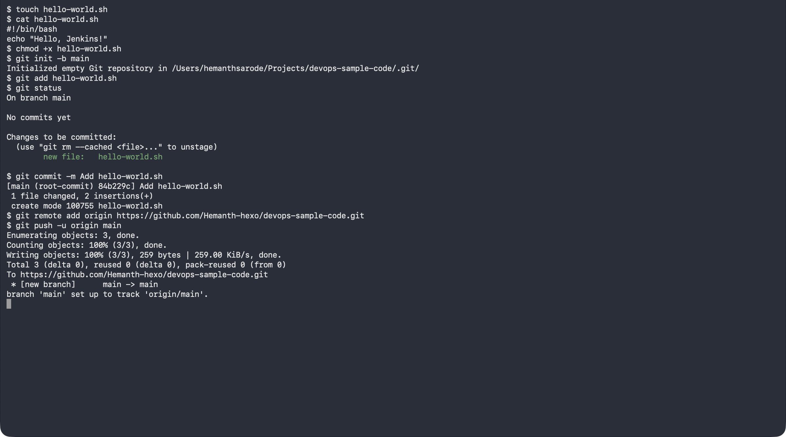
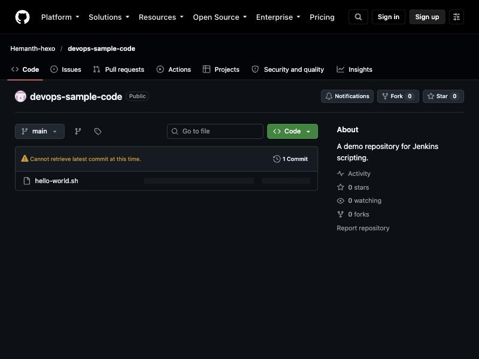
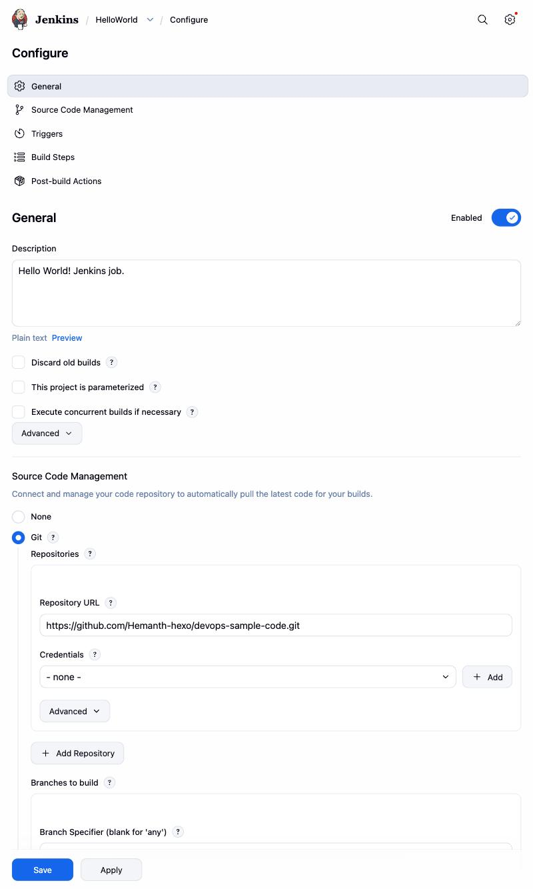
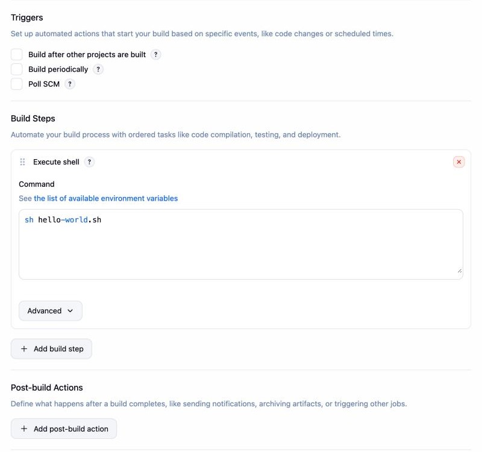
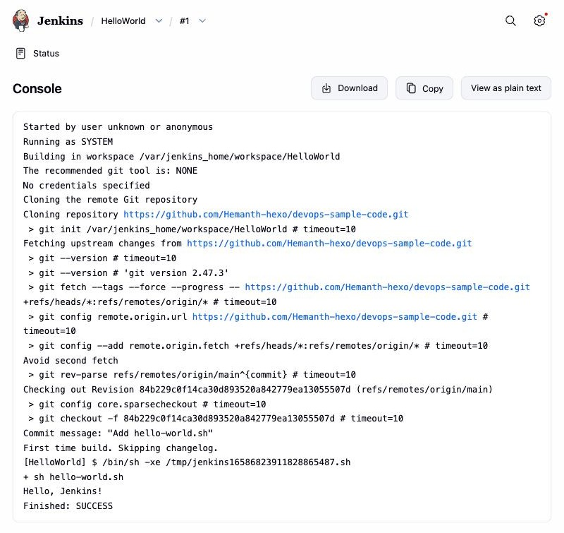

# Exercise 8: Creating a "Hello World" Jenkins Job

## Objective

Put a small shell script in a GitHub repository, then create a Jenkins
Freestyle job that checks the repository out with Git and runs the script.

## Environment

- Operating System: macOS (Apple Silicon)
- Jenkins: `jenkins/jenkins:lts` in Docker (with the Git plugin), on port `8081`
- GitHub repository: `devops-sample-code` (public)

## Part 1: Create the Script and Push It to GitHub

[hello-world.sh](./hello-world.sh):

```bash
#!/bin/bash
echo "Hello, Jenkins!"
```

Steps run in the terminal:

```bash
touch hello-world.sh          # then add the two lines above
chmod +x hello-world.sh
git init -b main
git add hello-world.sh
git status
git commit -m "Add hello-world.sh"
git remote add origin https://github.com/<account>/devops-sample-code.git
git push -u origin main
```

> The public repository `devops-sample-code` (description: "A demo
> repository for Jenkins scripting.") was created with the GitHub CLI
> (`gh repo create --public`), and pushing used the existing `gh` login, so a
> separate fine-grained personal access token was not needed.



The script is visible on GitHub:



## Part 2: Create the Jenkins Job

Jenkins runs in Docker (setup as in Exercise 7) with the Git plugin; the
setup wizard was skipped, so there is no login.

```bash
docker run -d --name dm-jenkins8 -p 8081:8080 -p 50000:50000 <jenkins-image-with-git-plugin>
```

A **Freestyle project** named `HelloWorld` was configured with:

- **Description:** `Hello World! Jenkins job.`
- **Source Code Management:** Git, repository URL `https://github.com/<account>/devops-sample-code.git`, branch `*/main`
- **Build step:** Execute shell, command `sh hello-world.sh`

> The job was created by posting its configuration (`config.xml`) to
> Jenkins' REST API rather than clicking through **New Item**; the result is
> the same Freestyle job, shown in its configure page below.





## Part 3: Build and View the Output

Triggered **Build Now**, then opened build **#1 → Console Output**. Jenkins
cloned the repository, ran the script and finished with `SUCCESS`:

```
Building in workspace /var/jenkins_home/workspace/HelloWorld
Cloning repository https://github.com/<account>/devops-sample-code.git
...
Commit message: "Add hello-world.sh"
+ sh hello-world.sh
Hello, Jenkins!
Finished: SUCCESS
```



---

## Result

The `hello-world.sh` script was committed and pushed to a public GitHub
repository, and a Jenkins Freestyle job pulled it from GitHub and printed
`Hello, Jenkins!` with a successful build.
