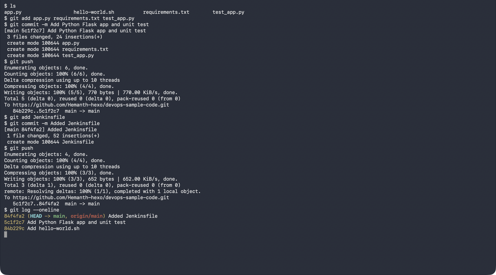
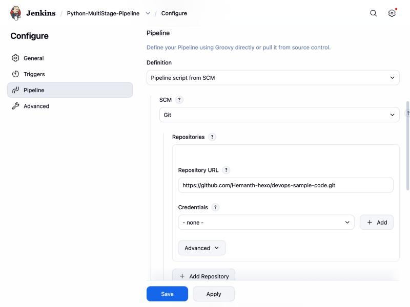
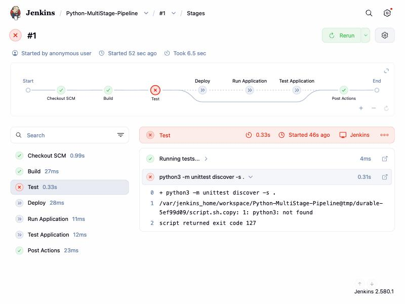
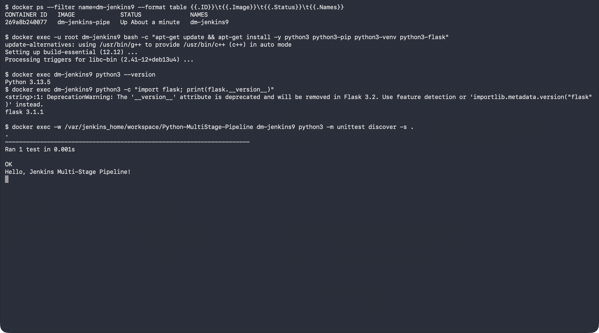
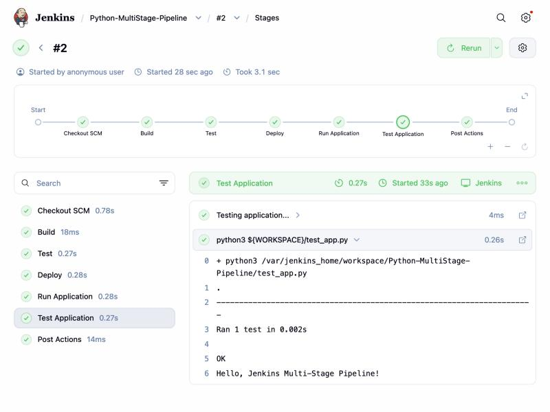
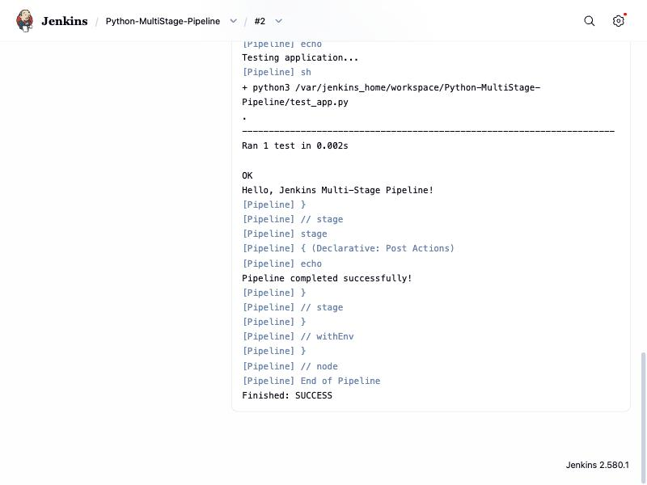

# Exercise 9: Jenkins Multi-Stage Pipeline for a Python Application

## Objective

Create and run a Jenkins Pipeline with multiple stages (Build, Test, Deploy,
Run Application, Test Application) for a small Python Flask application, with
the pipeline defined in a `Jenkinsfile` stored in Git.

## Environment

- Operating System: macOS (Apple Silicon)
- Jenkins: `jenkins/jenkins:lts` in Docker on port `8081`, with the Pipeline, Git and Pipeline Graph View plugins
- Repository: `devops-sample-code` on GitHub (same repository as Exercise 8)

## Step 1: Python Application

| File | Purpose |
|------|---------|
| [app.py](./app.py) | Flask app; `/` returns `Hello, Jenkins Multi-Stage Pipeline!` |
| [requirements.txt](./requirements.txt) | `flask==2.1.2` |
| [test_app.py](./test_app.py) | Unit test that calls `/` and checks the status code and text |
| [Jenkinsfile](./Jenkinsfile) | The multi-stage pipeline |

The pipeline stages:

1. **Build** – placeholder echo for dependency installation
2. **Test** – `python3 -m unittest discover -s .`
3. **Deploy** – copy `app.py` into `${WORKSPACE}/python-app-deploy`
4. **Run Application** – start the deployed app in the background with `nohup`
5. **Test Application** – run `test_app.py` again
6. **Post** – print a success or failure message

## Step 2: Push the Application and Jenkinsfile to GitHub

The files were added to the existing `devops-sample-code` repository in two
commits, the app first and then the `Jenkinsfile`:

```bash
git add app.py requirements.txt test_app.py
git commit -m "Add Python Flask app and unit test"
git push
git add Jenkinsfile
git commit -m "Added Jenkinsfile"
git push
```



## Step 3: Create the Pipeline Job

A **Pipeline** job named `Python-MultiStage-Pipeline` was created with
**Definition: Pipeline script from SCM**, **SCM: Git**, the repository URL,
branch `*/main` and script path `Jenkinsfile`.

> The job was created through Jenkins' REST API (posting its `config.xml`)
> rather than by clicking through **New Item**; the configure page below
> shows the resulting settings.



## Step 4: First Build Fails (Python Missing)

As the exercise warns, the first build failed: the stock Jenkins image has
no Python, so the **Test** stage stopped with `python3: not found` and the
remaining stages were skipped.



## Step 5: Install Python Inside the Jenkins Container

Installed Python and Flask in the running container as root:

```bash
docker exec -u root <jenkins-container> bash -c \
  "apt-get update && apt-get install -y python3 python3-pip python3-venv python3-flask"
```

> The exercise lists `python3.11-venv`; this Jenkins image is based on Debian
> 13 with Python 3.13, so the generic `python3-venv` package was used. Debian
> packages Flask 3.1, which the app and test work with unchanged.

Python 3.13.5 and Flask were then available, and the unit test passed when
run in the job's workspace:



## Step 6: Run the Pipeline Again

Build **#2** passed every stage: Checkout SCM, Build, Test, Deploy, Run
Application, Test Application and Post Actions.



The console output ends with the test result, the post-action message and
`Finished: SUCCESS`:



---

## Result

The Flask app, its unit test and the `Jenkinsfile` live in GitHub, and Jenkins
pulls the pipeline from the repository and runs it. After installing Python in
the Jenkins container (the build error the exercise anticipates), the
multi-stage pipeline builds, tests, deploys and re-tests the app successfully.
